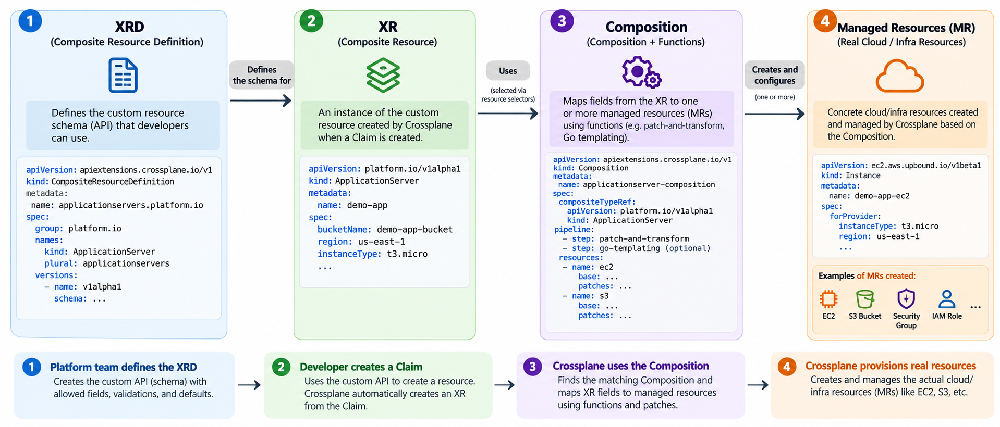
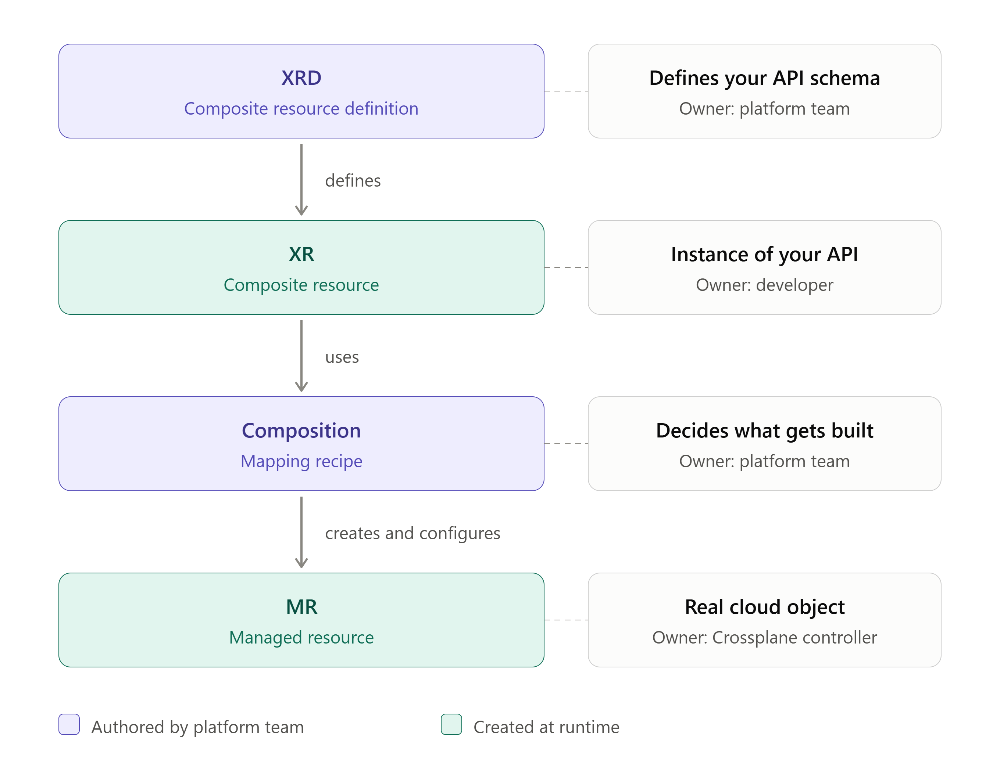

# Crossplane Simplified

Crossplane lets you expose a **Platform API** that end users can consume to create cloud resources, without needing to know the details underneath.

It is installed in a Kubernetes cluster using Helm. The install deploys the CRDs that let you manage cloud resources through Kubernetes.

> For simplicity, all examples below use **AWS**.

---

## 1. Getting Connected to AWS

Before Crossplane can do anything, it needs two things: a **Provider** and a **ProviderConfig**.

### Provider

A [Provider](https://marketplace.upbound.io/providers) is the bridge between Crossplane and AWS. It adds the CRDs for the AWS resources you want to manage. These resources are called **Managed Resources (MRs)**.

> **Managed Resource (MR):** a piece of cloud infrastructure (a database, storage bucket, VM, etc.) that you create and manage through Kubernetes.

Providers are split by AWS service. For example:

| Provider           | Managed Resources it gives you                                             |
| ------------------ | -------------------------------------------------------------------------- |
| `provider-aws-s3`  | Bucket, BucketLifecycleConfiguration, BucketPolicy, BucketVersioning, etc. |
| `provider-aws-ec2` | Instance, VPC, Subnet, ENI, etc.                                           |

### Credentials

A Provider only gives you a way to _talk_ to AWS. It still needs permission. That means credentials (via IAM).

There are many ways to authenticate (IRSA, Web Identity, etc.). To keep things simple, we use the basic approach:

1. Create a Kubernetes **Secret** from a credentials file.
2. Point Crossplane at that Secret.

### ProviderConfig

The [ProviderConfig](https://marketplace.upbound.io/providers/upbound/provider-family-aws/v2.9.1/resources/aws.m.upbound.io/ProviderConfig/v1beta1) ties everything together. It tells the Provider **which credentials to use** when authenticating to AWS.

---

## 2. How Crossplane Works at Runtime

Crossplane has 5 main components:

| #   | Component                               | What it is                                                                      | Terraform equivalent |
| --- | --------------------------------------- | ------------------------------------------------------------------------------- | -------------------- |
| 1   | **XRD** (Composite Resource Definition) | The schema. Defines what inputs are allowed.                                    | Module variables     |
| 2   | **Claim**                               | Created by the developer to supply the inputs.                                  | `tfvars`             |
| 3   | **XR** (Composite Resource)             | Created automatically by Crossplane. Holds the values from the Claim.           | n/a                  |
| 4   | **Managed Resource (MR)**               | The Crossplane resource that actually creates the AWS resource (S3, EC2, etc.). | Resource block       |
| 5   | **Composition**                         | Passes values from the XR to the MRs.                                           | Module body          |

### The flow

1. The developer creates a **Claim**.
2. Crossplane uses the **XRD** to create an **XR** from the Claim.
3. The XR holds the blueprint (from the XRD) plus the values (from the Claim).
4. The **Composition** takes the XR's values and patches them into the **Managed Resources**.
5. The MRs create the real AWS resources.

> **Note:** The Composition's output is not always a direct copy of the Claim. It can also apply defaults, transformations, and other logic.

### Crossplane resource flow diagrams

The first diagram shows the four main resources and how Crossplane connects them. The second highlights who defines, creates, and manages each resource.





---

## 3. Functions

In newer versions of Crossplane, Compositions use **Functions**. They are mandatory.

In this project, we use Functions for one simple job: **patching**, meaning copying values from the XR to the MRs. We use the community function `function-patch-and-transform`.

Functions run as **Pods**, managed by a Deployment.

---

## 4. Compositions

A Composition does two things:

- **Copies values** from the XR to the MRs.
- **Enforces standards**.

So a Composition holds two kinds of information:

1. **What the developer provides** (comes from the Claim, with the blueprint from the XRD).
2. **What the platform enforces** (hard-coded in the Composition).

**Example (S3 bucket):**

- The developer chooses: **region** and **name**.
- The platform enforces: **versioning enabled** and **public access disabled**.

---

## 5. PatchSet

In Crossplane, a single AWS resource is often split into several MRs. For example, an S3 bucket becomes:

- `Bucket`
- `BucketEncryption`
- `BucketACL`
- `BucketVersioning`

You might expect these to live under one S3 MR, but each one is its own separate MR.

**The problem:** these MRs often share fields. For example, they all belong to the same bucket, so they need the same **namespace** and **region**. Without help, you would repeat the same patch in every MR.

**The solution:** a **PatchSet**. You write the patch once, then reuse it wherever you need it.

See the Compositions in this project for an example.

---

## 6. Resource Discovery (Important)

Since `Bucket`, `BucketEncryption`, `BucketACL`, and `BucketVersioning` are separate MRs, how does each one know which bucket it belongs to?

The answer is **selectors**:

```yaml
spec:
  forProvider:
    bucketSelector:
      matchControllerRef: true
```

`matchControllerRef: true` tells the MR to find the bucket that was created by the **same XR** that created it.

Other ways to find the bucket include `matchLabels` and `namespace`. Use them when you need more control over which bucket gets selected.
